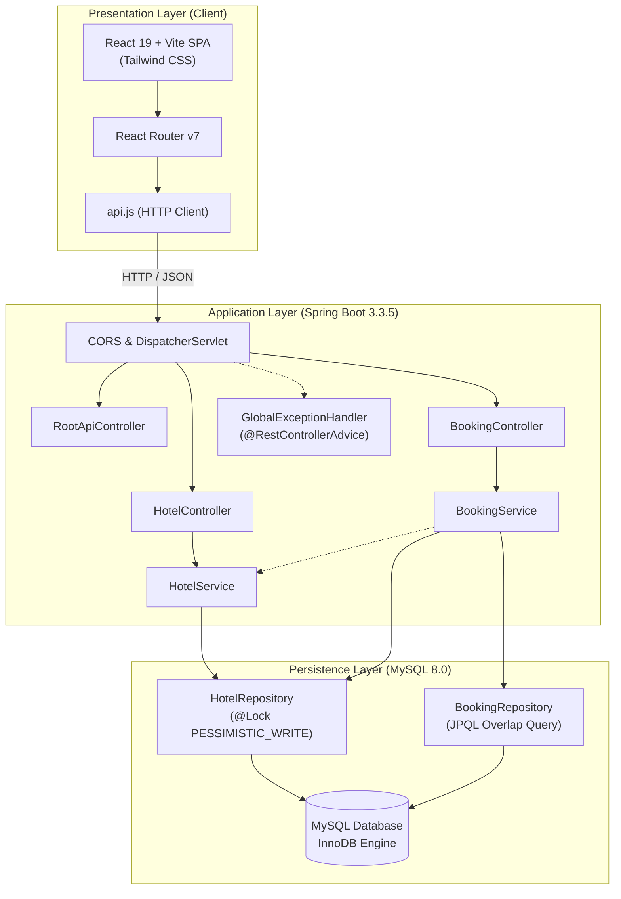
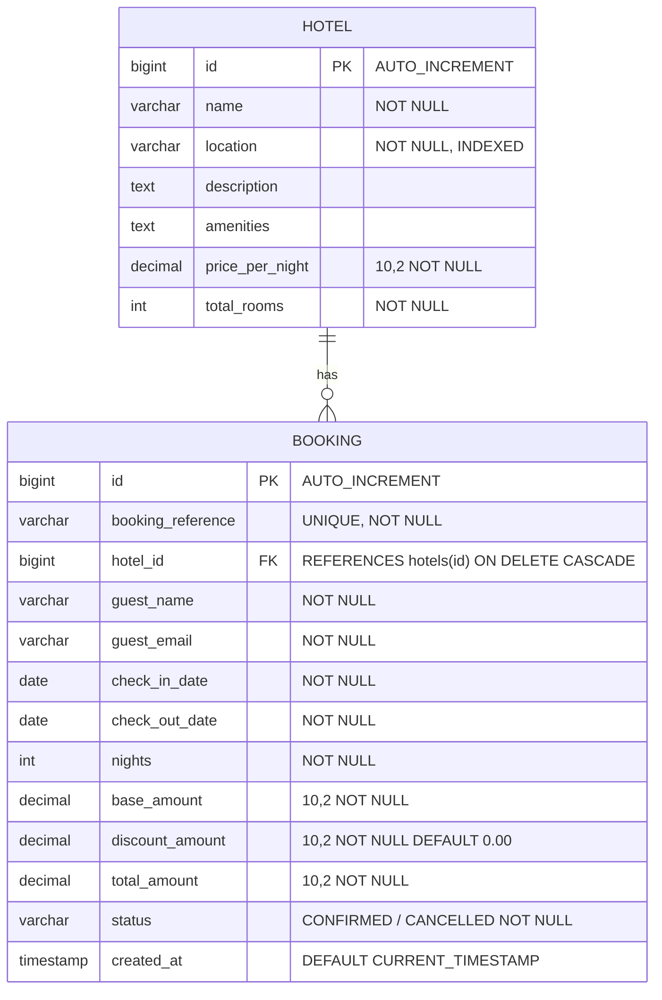
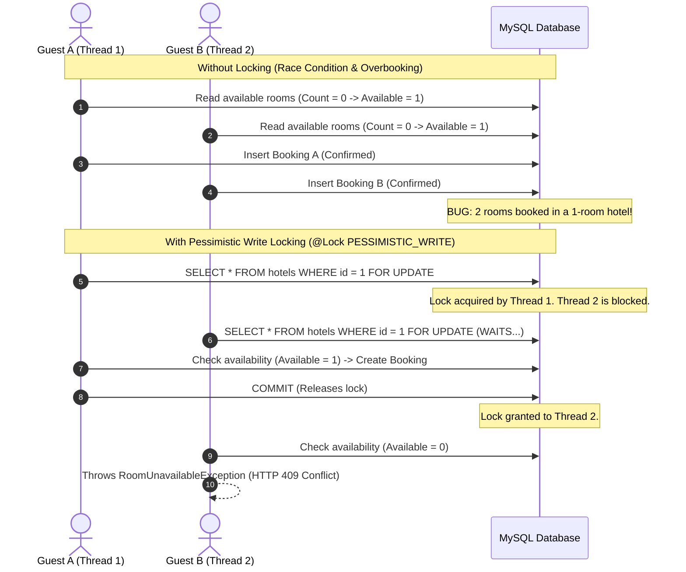

# 🏛️ StayHaven – Architecture & System Design Document

This document provides a comprehensive technical breakdown of the architecture, database modeling, concurrency safeguards, booking logic, and design decisions behind the **StayHaven Hotel Booking Portal**.

---

## 1. System Architecture

The application adopts a decoupled, multi-tier client-server architecture with strict separation of concerns across the presentation, application, and persistence layers.



### Component Breakdown
1. **Client Tier (React 19 + Vite)**:
   - Single Page Application (SPA) providing sub-second page transitions via React Router.
   - Synchronizes search state (`location`, `checkIn`, `checkOut`) with browser URL query parameters for shareable, bookmarkable searches.
   - Centralized API layer ([`api.js`](file:///d:/hotel_booking/frontend/src/services/api.js)) abstracting all HTTP interactions and parsing structured field-level errors.
2. **Application Tier (Spring Boot 3)**:
   - **REST Controllers**: Expose clean RESTful JSON endpoints with Jakarta Bean Validation (`@Valid`).
   - **Service Layer**: Houses core domain logic, temporal invariant checks, financial computations, and `@Transactional` boundaries.
   - **Global Exception Interceptor**: `@RestControllerAdvice` translates internal exceptions into standard HTTP error responses.
3. **Persistence Tier (Spring Data JPA / MySQL 8.0)**:
   - Powered by Hibernate ORM over the MySQL InnoDB storage engine.
   - Enforces relational referential integrity via foreign keys and row-level write locks.

---

## 2. Database Design & Relational Constraints

The persistence schema consists of two primary entities: **`Hotel`** and **`Booking`**.



### Table Definitions & Design Justifications

#### Table: `hotels`
| Column | Type | Constraints | Purpose |
| :--- | :--- | :--- | :--- |
| `id` | `BIGINT` | `PRIMARY KEY, AUTO_INCREMENT` | Unique identifier |
| `name` | `VARCHAR(255)` | `NOT NULL` | Property display name |
| `location` | `VARCHAR(255)` | `NOT NULL` | City/Destination name |
| `description` | `TEXT` | `NULLABLE` | Full marketing overview |
| `amenities` | `TEXT` | `NULLABLE` | Comma-separated feature tags |
| `price_per_night` | `DECIMAL(10,2)` | `NOT NULL` | Standard room rate in INR |
| `total_rooms` | `INT` | `NOT NULL` | Total inventory capacity |

- **Indexing Strategy**: An index `idx_hotels_location` is created on `location` to accelerate case-insensitive substring searches across popular tourist hubs.

#### Table: `bookings`
| Column | Type | Constraints | Purpose |
| :--- | :--- | :--- | :--- |
| `id` | `BIGINT` | `PRIMARY KEY, AUTO_INCREMENT` | Surrogate primary key |
| `booking_reference` | `VARCHAR(50)` | `UNIQUE, NOT NULL` | Human-readable identifier (`TCT-XXXXXX`) |
| `hotel_id` | `BIGINT` | `NOT NULL, FK` | Foreign key referencing `hotels(id)` |
| `guest_name` | `VARCHAR(255)` | `NOT NULL` | Primary guest full name |
| `guest_email` | `VARCHAR(255)` | `NOT NULL` | Contact email for verification |
| `check_in_date` | `DATE` | `NOT NULL` | Stay arrival date |
| `check_out_date` | `DATE` | `NOT NULL` | Stay departure date |
| `nights` | `INT` | `NOT NULL` | Stay duration in nights |
| `base_amount` | `DECIMAL(10,2)` | `NOT NULL` | $\text{price} \times \text{nights}$ |
| `discount_amount` | `DECIMAL(10,2)` | `NOT NULL DEFAULT 0.00` | Smart Stay discount amount |
| `total_amount` | `DECIMAL(10,2)` | `NOT NULL` | Final billed amount |
| `status` | `VARCHAR(20)` | `NOT NULL DEFAULT 'CONFIRMED'` | `CONFIRMED` or `CANCELLED` |
| `created_at` | `TIMESTAMP` | `DEFAULT CURRENT_TIMESTAMP` | Audit creation timestamp |

- **Composite Overlap Index (`idx_bookings_hotel_status_dates`)**:
  A composite index on `(hotel_id, status, check_in_date, check_out_date)` covers the exact predicates used by our room availability calculation. This allows MySQL to evaluate active overlapping stays directly within the B-Tree index without requiring full table scans.
- **Lookup Index (`idx_bookings_reference_email`)**:
  Enables fast case-insensitive lookups when guests retrieve their reservations.

---

## 3. REST API Design

All endpoints follow standard RESTful conventions, using standard HTTP verbs, clean resource identifiers, and uniform response bodies.

| Method | Endpoint | Purpose | Request Body | Success Code |
| :--- | :--- | :--- | :--- | :---: |
| `GET` | `/` or `/api` | Server health & API discovery index | None | `200 OK` |
| `GET` | `/api/hotels` | Search hotels with optional date availability | Query Params (`location`, `checkIn`, `checkOut`) | `200 OK` |
| `GET` | `/api/hotels/{id}` | Get hotel details & live pricing breakdown | Query Params (`checkIn`, `checkOut`) | `200 OK` |
| `POST` | `/api/bookings` | Reserve a room with pessimistic lock protection | JSON (`hotelId`, `guestName`, `guestEmail`, `checkInDate`, `checkOutDate`) | `201 Created` |
| `GET` | `/api/bookings/lookup` | Retrieve reservation details | Query Params (`reference`, `email`) | `200 OK` |
| `POST` | `/api/bookings/{reference}/cancel` | Cancel an existing reservation | JSON (`{ "email": "..." }`) | `200 OK` |

### Consistent Error Structure
All errors across the platform are captured by `GlobalExceptionHandler` and returned as a structured JSON object:
```json
{
  "timestamp": "2026-11-13T14:00:00",
  "status": 400,
  "error": "Bad Request",
  "message": "Validation failed for one or more fields",
  "fieldErrors": {
    "guestEmail": "Please provide a valid email address",
    "guestName": "Guest name is required"
  }
}
```

---

## 4. Booking Logic & Invariant Rules

### A. Mathematical Stay Overlap Logic
In hospitality semantics, a booking reservation from $\text{CheckIn}$ to $\text{CheckOut}$ occupies nights up to—but not including—the departure morning. That means a guest departing on Dec 15 vacates the room for another guest checking in on Dec 15.

Two date intervals $[S_1, E_1)$ and $[S_2, E_2)$ overlap if and only if:
$$\text{Overlap} \iff S_1 < E_2 \land E_1 > S_2$$

This is translated to the following JPQL query in [`BookingRepository.java`](file:///d:/hotel_booking/backend/src/main/java/com/hotelbooking/repository/BookingRepository.java):
```sql
SELECT COUNT(b) FROM Booking b
WHERE b.hotel.id = :hotelId
  AND b.status = 'CONFIRMED'
  AND b.checkInDate < :checkOut
  AND b.checkOutDate > :checkIn
```

**Why strict inequalities (`<` and `>`) are critical:**
- If Booking 1 is Dec 10–15 and Booking 2 is Dec 15–20:
  $\text{checkIn}_2 (15) < \text{checkOut}_1 (15)$ is **FALSE**.
  Therefore, no overlap is detected, allowing 100% room efficiency without artificial off-by-one gaps.

### B. Dynamic Room Availability Calculation
Rather than maintaining a denormalized `available_rooms` counter on the `hotels` table (which is vulnerable to drift and race conditions), available capacity is calculated on demand:
$$\text{availableRooms} = \text{totalRooms} - \text{activeOverlappingBookings}$$

When a booking is cancelled (`status = 'CANCELLED'`), the query automatically filters it out on the subsequent read. Room availability is **immediately restored** without running any asynchronous reconciliation jobs.

### C. Strict Temporal Invariants
Before querying the database, the service layer enforces:
1. `checkIn >= LocalDate.now()` (prevents booking dates in the past).
2. `checkOut > checkIn` (prevents inverted dates or 0-night stays).

---

## 5. Design Decisions, Trade-Offs & Alternatives Considered

| Decision | Chosen Approach | Alternative Considered | Trade-Off & Reason |
| :--- | :--- | :--- | :--- |
| **Room Inventory Tracking** | **Dynamic Calculation** via overlapping bookings | Static `available_rooms` column in `hotels` table | A static column cannot represent room availability across varying future date ranges. Dynamic calculation accurately accounts for individual day availability without synchronization drift. |
| **Financial Representation** | `BigDecimal` with `DECIMAL(10,2)` | `double` or `float` | Floating point numbers suffer from binary IEEE-754 precision loss (`0.1 + 0.2 = 0.30000000000000004`). `BigDecimal` ensures exact monetary rounding to the penny. |
| **Cancellation Payload** | **JSON Body** (`POST /api/bookings/{ref}/cancel`) | URL query parameter (`?email=...`) | Query parameters are frequently logged in plain text by reverse proxies and browser history. Passing email in the encrypted HTTP request body protects guest PII. |
| **Entity Exposure** | **Strict DTO Mapping** | Returning JPA Entities directly | Returning entities risks circular serialization loops, accidental schema leaks, and prevents adding computed transient fields like `availableRooms` and `demandStatus`. |
| **Search State Management** | **URL SearchParams Sync** | Internal React Component State | Synchronizing with `useSearchParams()` allows users to refresh, bookmark, or share search results directly via URL. |

---

## 6. Simultaneous Bookings & Concurrency Control

### The Concurrency Problem
Consider a hotel with only 1 room remaining (`total_rooms = 1`, `active_bookings = 0`).
At the exact same millisecond ($t_0$), two distinct guests—**User A** and **User B**—click "Confirm & Book Room" for the same stay dates.



### Our Implementation: Pessimistic Write Locking (`FOR UPDATE`)

In [`HotelRepository.java`](file:///d:/hotel_booking/backend/src/main/java/com/hotelbooking/repository/HotelRepository.java):
```java
@Lock(LockModeType.PESSIMISTIC_WRITE)
@Query("SELECT h FROM Hotel h WHERE h.id = :id")
Optional<Hotel> findByIdWithLock(@Param("id") Long id);
```

When [`BookingService.createBooking`](file:///d:/hotel_booking/backend/src/main/java/com/hotelbooking/service/BookingService.java) executes inside a `@Transactional` block:
1. Hibernate acquires an exclusive row-level lock on the hotel record by issuing native SQL:
   ```sql
   SELECT id, name, location, price_per_night, total_rooms 
   FROM hotels 
   WHERE id = ? 
   FOR UPDATE;
   ```
2. Any concurrent transaction attempting to reserve a room for the same hotel must wait until the first transaction commits or rolls back.
3. Once the lock is acquired, the second transaction re-evaluates the active booking count:
   $$\text{availableRooms} = \text{totalRooms} - \text{countActiveOverlappingBookings()}$$
4. If `availableRooms <= 0`, the transaction aborts and throws `RoomUnavailableException`, which the global exception handler renders as a clean **`HTTP 409 Conflict`** with a friendly error message:
   ```json
   {
     "status": 409,
     "error": "Conflict",
     "message": "Sorry, no rooms are available at The Grand Heritage Palace for the selected dates."
   }
   ```

### Why Pessimistic Locking Was Chosen Over Optimistic Locking
- With **Optimistic Locking** (`@Version`), both transactions would execute concurrently, and the second transaction would fail at commit time with an `OptimisticLockException`. For an end user who just spent minutes typing in guest information, having the application fail at the final commit step with an unexpected rollback produces poor UX.
- In reservation systems with high contention on the last remaining room, **Pessimistic Locking** serializes access cleanly, ensuring that inventory counts are atomic and accurate.

---

## 7. Surprise Feature: "Smart Stay Pricing & Demand Insights"

### Purpose
To solve two common user problems:
1. **Extended Stay Incentive**: Long-term travelers (e.g. week-long vacations in Goa or remote work stays in Manali) typically look for discounts when booking longer stays.
2. **Transparent Inventory Scarcity**: Users want clear, honest demand signals without deceitful urgency tactics.

### Technical Implementation

#### A. Long-Stay 10% Discount
Implemented inside [`HotelService.calculatePriceBreakdown()`](file:///d:/hotel_booking/backend/src/main/java/com/hotelbooking/service/HotelService.java):
- If $\text{nights} \ge 4$:
  $$\text{discountAmount} = \text{baseAmount} \times 0.10$$
  $$\text{totalAmount} = \text{baseAmount} - \text{discountAmount}$$
- If $\text{nights} < 4$:
  $$\text{discountAmount} = 0.00$$
  $$\text{totalAmount} = \text{baseAmount}$$

#### B. Demand Scarcity Insights State Machine
Evaluated based on remaining room count:
$$\text{DemandStatus} = \begin{cases} 
\text{"SOLD\_OUT"} & \text{if } \text{availableRooms} \le 0 \\
\text{"HIGH\_DEMAND"} & \text{if } \text{availableRooms} = 1 \\
\text{"AVAILABLE"} & \text{if } \text{availableRooms} > 1 
\end{cases}$$

- In the UI, `"HIGH_DEMAND"` activates a pulsing amber badge: **"High Demand: Only 1 room left!"**, providing an honest, verified signal of property demand.

---

## 8. Limitations & Future Improvements

While the application meets and exceeds all requirements of the technical assessment, the following enhancements could be incorporated in a large-scale commercial deployment:

1. **Multi-Room & Room Categories**:
   - Currently, the portal models a single room category per hotel. Extending the schema to support multiple room tiers (e.g., *Deluxe Suite*, *Ocean Villa*, *Standard Room*) with individual pricing and inventory would accommodate complex hotel setups.
2. **Payment Gateway Two-Phase Commit**:
   - Integrating a payment gateway (e.g., Stripe, Razorpay) using a temporary `PENDING_PAYMENT` hold status with a 15-minute expiration timer (via Redis TTL or scheduled worker) before final confirmation.
3. **Distributed Caching (Redis)**:
   - For high-traffic hotel searches, static hotel metadata can be cached in Redis with cache invalidation triggered on room updates.
4. **Guest Authentication & Booking History**:
   - Adding Spring Security with JWT tokens to allow guests to log in, view past booking histories, and download PDF receipts.
